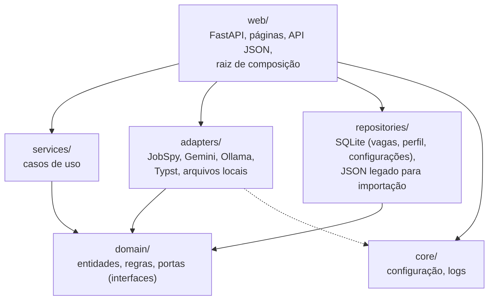
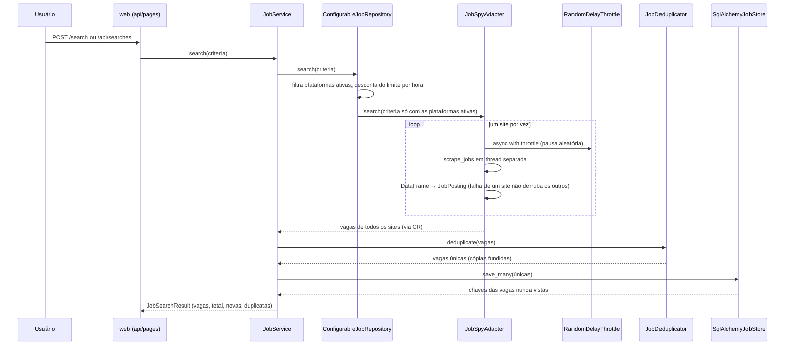
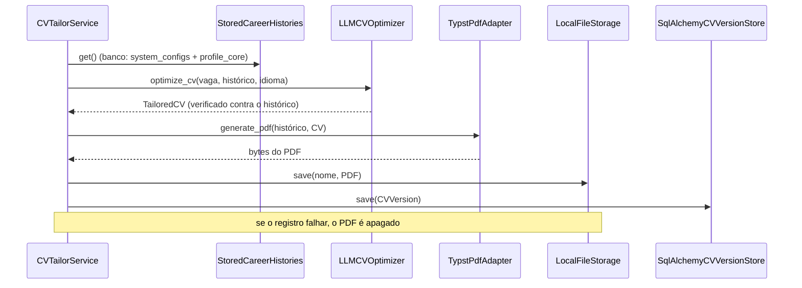
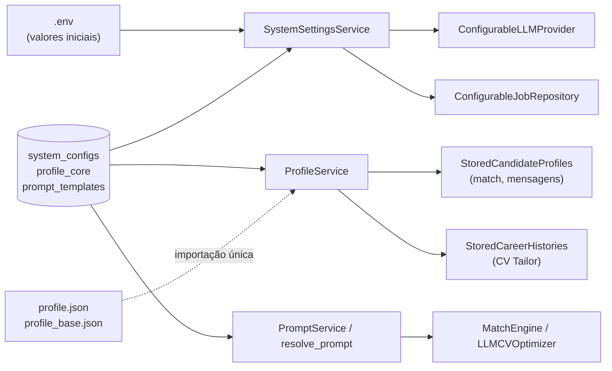

# Arquitetura

O copilot-job-gil busca vagas em sites de emprego, remove duplicatas entre fontes, avalia a
aderência de cada vaga ao perfil do candidato com um LLM, gera rascunhos de mensagens para
recrutadores e produz currículos em PDF otimizados para ATS sob medida para cada vaga
(CV Tailor). É uma aplicação pessoal, local, com interface web (FastAPI + Jinja2 + Tailwind)
e API JSON.

Este documento explica **como o código está organizado e por quê**. Para instalar e usar, veja
o [Guia do Usuário](USER_GUIDE.md).

## Sumário

1. [Camadas e regra de dependência](#1-camadas-e-regra-de-dependência)
2. [Estrutura de pastas](#2-estrutura-de-pastas)
3. [Portas e implementações](#3-portas-e-implementações)
4. [Fluxos principais](#4-fluxos-principais)
5. [Decisões de design](#5-decisões-de-design) (inclui o [painel de configurações](#56-painel-de-configurações-e-perfil-no-banco))
6. [Banco de dados e migrações](#6-banco-de-dados-e-migrações)
7. [Segurança](#7-segurança)
8. [Testes](#8-testes)
9. [Como estender](#9-como-estender)
10. [Limitações conhecidas](#10-limitações-conhecidas)

---

## 1. Camadas e regra de dependência



**Regra central: tudo aponta para `domain/`, e `domain/` não aponta para nada.** O domínio
não importa FastAPI, SQLAlchemy, JobSpy, pandas nem SDKs de LLM, só a biblioteca padrão.

| Camada | Responsabilidade | Pode depender de |
|---|---|---|
| `domain/` | Entidades imutáveis, regras de negócio puras (chave de deduplicação, fusão de cópias, veredito do match, limites de canal, integridade do CV), portas (interfaces) e erros de domínio | nada |
| `services/` | Casos de uso: orquestram portas para cumprir um objetivo (buscar, avaliar, redigir, editar perfil e configurações) | `domain/` |
| `adapters/` | Traduzem serviços externos (JobSpy, Gemini, Ollama, compilador Typst, sistema de arquivos) para as portas do domínio, convertendo erros de biblioteca em erros de domínio | `domain/`, `core/` |
| `repositories/` | Persistência: SQLite via SQLAlchemy assíncrono (inclusive perfil, configurações do painel e prompts); os JSON de perfil só como fonte da importação inicial | `domain/` |
| `web/` | HTTP (páginas e API), tradução de erros em status HTTP, e a **raiz de composição**, o único lugar que conhece as implementações concretas | todas |
| `core/` | Configuração (`pydantic-settings`) e logs | nada do projeto |

Consequência prática: trocar o Ollama pelo Gemini, o SQLite por outro banco ou o JobSpy por outra
fonte não altera nenhuma linha de `domain/` nem de `services/`. A troca entre Ollama e Gemini pode
inclusive ser feita pelo painel, com a aplicação rodando (seção 5.6).

## 2. Estrutura de pastas

```
app/
├── core/
│   ├── config.py              Settings: variáveis de ambiente e .env (valores iniciais), validadas na subida
│   └── logging.py
├── domain/
│   ├── models.py              Entidades, value objects e regras puras
│   ├── interfaces.py          Portas (ABCs) que services e web usam
│   └── exceptions.py          Hierarquia DomainError
├── services/
│   ├── job_service.py         Busca, deduplicação e persistência; aponta vagas novas
│   ├── deduplication.py       Agrupa cópias da mesma vaga e as funde
│   ├── match_engine.py        Score híbrido: skills + avaliação do LLM
│   ├── match_service.py       Match com cache invalidado pelo perfil
│   ├── outreach_service.py    Rascunhos de mensagens para recrutadores
│   ├── cv_optimizer.py        LLMCVOptimizer: conteúdo do CV por vaga, com checagem de integridade
│   ├── cv_tailor_service.py   Otimiza, gera o PDF, grava o arquivo e registra a versão
│   ├── cv_file_janitor.py     Encontra e remove PDFs sem versão registrada
│   ├── profile_service.py     ProfileService: perfil no banco, importação legada; portas do match e do CV
│   ├── system_settings_service.py  LLM e conectores: banco por cima dos padrões do .env
│   ├── prompt_service.py      Prompts editáveis e DEFAULT_PROMPTS (padrões no código)
│   └── prompts.py             resolve_prompt: personalizado ativo ou padrão
├── adapters/
│   ├── jobspy_adapter.py      IJobRepository sobre python-jobspy
│   ├── configurable_job_repository.py  Proxy: plataformas ativas, limite por hora, recria o JobSpyAdapter
│   ├── rate_limit.py          RandomDelayThrottle (pausa aleatória) e HourlyRequestBudget (limite por hora)
│   ├── gemini_adapter.py      ILLMProvider sobre google-genai
│   ├── ollama_adapter.py      ILLMProvider sobre a API REST do Ollama (httpx)
│   ├── configurable_llm.py    Proxy: relê LLMSettings a cada chamada e recria o adapter
│   ├── llm_factory.py         llm_settings_from_env, build_llm_adapter
│   ├── job_repository_factory.py  scraper_settings_from_env, build_jobspy_repository
│   ├── typst_pdf_adapter.py   ICVGenerator: compila o template Typst em PDF
│   └── local_file_storage.py  IFileStorage: PDFs em output_cvs/
├── repositories/
│   ├── database.py            Engine, sessões, PRAGMAs e transação de escrita
│   ├── orm.py                 Tabelas (nunca expostas ao domínio), inclusive as do painel
│   ├── job_store.py           IJobStore
│   ├── match_store.py         IMatchResultStore
│   ├── outreach_store.py      IOutreachStore
│   ├── cv_version_store.py    ICVVersionStore
│   ├── system_config_store.py ISystemConfigStore: tabela system_configs
│   ├── profile_block_store.py IProfileBlockStore: tabela profile_core
│   ├── prompt_template_store.py  IPromptTemplateStore: tabela prompt_templates
│   ├── json_file.py           Leitura validada de JSON do usuário
│   ├── profile_repository.py  profile.json: só fonte da importação inicial
│   ├── career_history_repository.py  profile_base.json: só fonte da importação inicial
│   ├── migrate.py             Aplica as migrações a partir do código
│   └── migrations/            Alembic (env.py e versions/)
└── web/
    ├── app.py                 create_app(): FastAPI, lifespan, rotas, erros
    ├── container.py           Raiz de composição: monta e libera as dependências
    ├── api.py                 Rotas /api/* (JSON)
    ├── pages.py               Rotas HTML
    ├── settings_pages.py      Rotas /settings/* (painel de configurações)
    ├── settings_forms.py      Formulários do painel (Pydantic)
    ├── schemas.py             Contratos HTTP (Pydantic), também usados pelos templates
    ├── dependencies.py        Dependências do FastAPI e proteção de origem (CSRF)
    ├── errors.py              DomainError → status HTTP (JSON ou HTML)
    ├── templating.py          Jinja2: filtros e rótulos em português
    ├── templates/             Inclui settings/ (abas do painel) e components/ui/
    └── static/js/settings.js  Comportamento dos formulários do painel
app/maintenance.py             Linha de comando de manutenção (limpeza de PDFs órfãos)
templates/cv/                  Template Typst do CV (ats_base.typ) e dados de exemplo
output_cvs/                    PDFs gerados (fora do repositório)
tests/
├── doubles.py                 Dublês compartilhados (LLM, fonte de vagas, stores em memória)
├── conftest.py                Banco SQLite em memória criado pelas migrações reais
├── unit/                      Regras de negócio, services e adapters, isolados
├── regression/                Deduplicação, contratos das portas, migrações, concorrência
└── e2e/                       Aplicação completa via HTTP (API e páginas)
profile_data/                  *.example.json (versionados); profile.json e profile_base.json (locais, só importados)
main.py                        Ponto de entrada (uvicorn em 127.0.0.1:8000)
```

## 3. Portas e implementações

As portas ficam em `app/domain/interfaces.py`. Cada uma é pequena e tem um único papel. Buscar
vagas na web (`IJobRepository`) e guardá-las (`IJobStore`) são portas separadas, porque mudam
por motivos diferentes.

| Porta | Papel | Implementação | Dublê de teste |
|---|---|---|---|
| `IJobRepository` | Buscar vagas em fontes externas | `ConfigurableJobRepository` → `JobSpyAdapter` | `FakeJobRepository` |
| `IJobStore` | Guardar vagas já vistas; informar quais são novas | `SqlAlchemyJobStore` | `InMemoryJobStore` |
| `IMatchResultStore` | Guardar o match de cada vaga | `SqlAlchemyMatchResultStore` | `InMemoryMatchResultStore` |
| `IOutreachStore` | Histórico de rascunhos por vaga | `SqlAlchemyOutreachStore` | `InMemoryOutreachStore` |
| `IProfileRepository` | Fornecer o perfil do candidato | `StoredCandidateProfiles` (banco); `JsonProfileRepository` só na importação | (arquivo temporário importado) |
| `ICareerHistoryRepository` | Fornecer o histórico profissional completo | `StoredCareerHistories` (banco); `JsonCareerHistoryRepository` só na importação | (arquivo temporário importado) |
| `ISystemConfigStore` | Pares chave/valor do painel (LLM, conectores, dados gerais do perfil) | `SqlAlchemySystemConfigStore` | `InMemorySystemConfigStore` |
| `IProfileBlockStore` | Experiências, competências e conquistas | `SqlAlchemyProfileBlockStore` | `InMemoryProfileBlockStore` |
| `IPromptTemplateStore` | Prompts personalizados | `SqlAlchemyPromptTemplateStore` | `InMemoryPromptTemplateStore` |
| `ICVOptimizer` | Adaptar o conteúdo do CV a uma vaga | `LLMCVOptimizer` | `LLMCVOptimizer` + `MockLLMAdapter` |
| `ICVGenerator` | Gerar o PDF do CV | `TypstPdfAdapter` | `FakeGenerator` (nos testes) |
| `ICVVersionStore` | Registrar as versões de CV por vaga | `SqlAlchemyCVVersionStore` | `InMemoryCVVersionStore` |
| `IFileStorage` | Guardar os PDFs gerados | `LocalFileStorage` | `InMemoryFileStorage` |
| `ILLMProvider` | Gerar texto e JSON; `current_name()` informa o provedor em uso | `ConfigurableLLMProvider` → `GeminiAdapter`, `OllamaAdapter` | `MockLLMAdapter`, `ScriptedLLMAdapter` |

A otimização do CV é uma porta própria (`ICVOptimizer`), e não um método da `ILLMProvider`:
otimizar um CV é regra de negócio, não uma capacidade do provedor. Assim qualquer provedor de LLM
serve ao CV Tailor sem implementar nada específico dele.

**Contrato de erros.** Adapters e repositórios nunca deixam escapar exceções de bibliotecas
externas. Eles as convertem em erros de `app/domain/exceptions.py`, que a camada web traduz em
status HTTP:

| Erro de domínio | Significado | HTTP |
|---|---|---|
| `JobNotFoundError` | Vaga não armazenada | 404 |
| `ProfileBlockNotFoundError` | Experiência, competência ou conquista inexistente | 404 |
| `CVVersionNotFoundError` | Versão de CV inexistente, ou PDF removido do disco | 404 |
| `SourcesDisabledError` | Nenhuma das plataformas pedidas está ativa no painel | 422 |
| `RateLimitExceededError` | Limite de requisições por hora atingido (a mensagem diz quantos minutos esperar) | 429 |
| `CVRenderError` | Falha ao compilar o template do CV | 500 |
| `JobSourceError` | Todas as fontes de vagas falharam | 502 |
| `CVIntegrityError` | O LLM não produziu um CV fiel ao histórico, nem após correção | 502 |
| `LLMResponseFormatError` | O LLM respondeu fora do contrato | 502 |
| `OutreachGenerationError` | O LLM não respeitou o limite do canal nem após reescrita | 502 |
| `LLMProviderError` | O LLM não respondeu (fora do ar, quota, timeout) | 503 |
| `ProfileError` | Perfil ou histórico profissional não cadastrado ou inválido | 503 |

Nas rotas `/api/*` a resposta é JSON (`{"detail": "..."}`); nas páginas, `error.html`.

## 4. Fluxos principais

### 4.1 Busca de vagas



### 4.2 Match perfil × vaga

`MatchEngine` calcula um **score híbrido**:

```
keyword_score = 100 × (skills do perfil citadas na vaga) / (total de skills do perfil)
score         = 0,4 × keyword_score + 0,6 × nota do LLM (0–100)
```

- Skills são comparadas sem diferenciar maiúsculas nem acentos, por palavra inteira: "Java" não
  casa com "JavaScript", e "C#" e "Node.js" funcionam.
- A nota do LLM é limitada a 0–100. Se o LLM falhar ou responder fora do contrato, o engine
  **degrada** para `score = keyword_score` e marca o resultado como "sem LLM".
- Veredito: ≥ 80 forte · ≥ 65 bom · ≥ 45 fraco · abaixo disso, pouca aderência.

`MatchService` adiciona o cache. O match salvo é reaproveitado **somente se**:

1. foi calculado com o perfil atual (mesmo `CandidateProfile.fingerprint`; `experiences` e
   `achievements` só entram no fingerprint quando preenchidos, então matches antigos continuam
   válidos), **e**
2. usou o LLM (um match de fallback é recalculado na próxima oportunidade).

Caso contrário, ou com `force=True`, o match é recalculado e gravado por cima do anterior.

O prompt do match inclui, além de skills e resumo, uma linha por experiência ativa e as métricas e
conquistas. O system prompt é o personalizado em `prompt_templates`, se houver um ativo, ou o
padrão do código (seção 5.6).

### 4.3 Mensagens para recrutadores

`OutreachService.draft()` monta um prompt com o perfil (a única fonte de fatos permitida), a vaga
e, se o match for do perfil atual, as skills em comum e os pontos fortes. As lacunas nunca
entram. O system prompt proíbe inventar fatos, mencionar pontos fracos e usar placeholders.

| Canal | Limite do corpo | Assunto |
|---|---|---|
| Convite de conexão (LinkedIn) | 300 (limite da plataforma) | não |
| Mensagem (LinkedIn) | 1000 (escolha editorial) | não |
| E-mail | 1500 (escolha editorial) | obrigatório |

Se o corpo vier acima do limite, o serviço pede **uma** reescrita ao LLM, informando o tamanho
obtido. Se ainda vier longo, lança `OutreachGenerationError`: cortar a mensagem a deixaria sem
sentido. Cada geração cria um novo rascunho; o histórico nunca é sobrescrito.

### 4.4 CV Tailor



**Fatos × conteúdo adaptado.** O `CareerHistory` (histórico completo) é a única fonte de fatos.
Ele inclui as `achievements` (métricas e conquistas do painel), que entram no `full_text`: um
número citado numa conquista pode lastrear um número do resumo do CV, e o prompt as lista como
"podem ser citadas no resumo".
O `TailoredCV` só **seleciona e reescreve**: título, resumo, skills e highlights por experiência.
Nome, contato, empresas, datas, formação e certificações vêm sempre do histórico, na montagem
dos dados do template (`build_render_data`).

**Integridade (`TailoredCV.violations_against`).** O CV otimizado é recusado se:

| Regra | Pega |
|---|---|
| Toda experiência referenciada existe no histórico, sem repetição | Empregos inventados |
| Toda skill foi declarada ou usada em alguma experiência | Skills que o candidato não tem |
| Todo número de um highlight aparece no texto daquela mesma experiência | Métricas inventadas ou alteradas ("800 ms → 50 ms") |
| Todo número do título e do resumo aparece em algum ponto do histórico | "12 anos de experiência" quando são 6 |
| No mesmo idioma do histórico, ≥ 50% das palavras significativas de cada highlight vêm daquela experiência (comparação por radicais) | Responsabilidades copiadas da descrição da vaga e apresentadas como experiência |

A última regra nasceu de um caso real: o `llama3.1` transformou requisitos da vaga ("Apoiei a
análise de requisitos técnicos") em experiência do candidato, e as outras regras não pegavam.

**Três camadas no `LLMCVOptimizer`:**

1. o prompt proíbe inventar e exige números copiados exatamente;
2. se houver violações, o LLM recebe a lista e reescreve **uma** vez. Resposta fora do formato
   também ganha uma nova tentativa, com o motivo;
3. se ainda houver violações, o código **remove** o que não tem lastro: skill desconhecida sai,
   highlight inválido sai, experiência sem highlights volta com os originais, e título ou
   resumo com número inventado voltam ao texto do histórico. Como só remove, o resultado é
   sempre fiel.

**Decisões determinísticas, no código e não no LLM:** todas as experiências entram (lacunas na
trajetória prejudicam a candidatura), em ordem cronológica reversa, com até 5 highlights cada e
até 20 skills. As palavras-chave declaradas como "cobertas" são filtradas para as que o CV de fato
contém.

**Template ATS (`templates/cv/ats_base.typ`).** Uma coluna, sem tabelas, ícones ou imagens;
contato no corpo (não em cabeçalho ou rodapé); títulos de seção padrão em português ou inglês;
sem hifenização e sem ligaduras, para a extração de texto não quebrar palavras-chave; metadados
de título, autor e palavras-chave. O Typst sempre marca a estrutura do PDF (títulos, listas,
ordem de leitura); com `CV_PDF_STANDARD=ua-1` (padrão) ele também valida os requisitos de
acessibilidade PDF/UA-1 e declara a conformidade. Os dados entram como JSON em `sys.inputs` e
são sempre tratados como texto: marcação Typst vinda do histórico ou do LLM nunca é executada.

**Arquivos e versões.** Cada geração cria uma `CVVersion` nova, com o conteúdo otimizado completo
no banco e o PDF em `output_cvs/`, com o nome `<Nome>_CV_<Empresa>_<id>.pdf`. O id completo
garante que uma versão nunca sobrescreva o PDF de outra, e o `LocalFileStorage` recusa
sobrescrever arquivos. `CVVersion.download_name` oferece o nome sem o id para quem recebe o
arquivo. Nomes com barras ou `..` são recusados, então uma referência adulterada no banco não
consegue ler nem apagar fora da pasta.

**Na web.** `POST /api/jobs/{key}/cvs` (e o formulário da página da vaga) gera uma versão;
`GET /api/jobs/{key}/cvs` e `GET /api/cvs/{id}` listam e detalham; `GET /api/cvs/{id}/pdf` serve
o arquivo com `Content-Disposition` (`inline`, ou `attachment` com `?download=true`), usando o
`download_name`, além de `X-Content-Type-Options: nosniff` e `Cache-Control: private, no-store`.
O id da versão é validado pelo formato (32 hexadecimais) antes de chegar ao banco. A página
compara cada versão com o histórico atual e marca as desatualizadas.

**Tempo limite próprio.** O CV é uma resposta longa: com LLM local no processador, passou de
2 minutos nos testes reais. O container cria uma instância do provedor só para o CV, com
`CV_LLM_TIMEOUT_SECONDS` (padrão 600 s), e a análise de match continua falhando rápido.

## 5. Decisões de design

### 5.1 Chave de deduplicação (`JobPosting.dedup_key`)

A mesma vaga aparece em sites diferentes com formatações diferentes. A chave é um SHA-256
(16 caracteres) de três partes normalizadas:

| Parte | Normalização | Exemplo |
|---|---|---|
| Título (`canonical_title`) | minúsculas, sem acentos e sem pontuação; remove palavras que não mudam qual vaga é (modo de trabalho, país, conectivos, marcador de gênero "(a)"); **conjunto ordenado** de palavras | "Desenvolvedor(a) Python Sênior - Remoto" → `desenvolvedor python senior` |
| Empresa (`canonical_company`) | sem sufixo societário | "ACME Ltda.", "Acme S.A." → `acme` |
| Local (`canonical_location`) | só a cidade | "São Paulo, SP, BR", "São Paulo - SP" → `sao paulo` |

**A senioridade é preservada**: "Senior" e "Junior", ou "Engineer I" e "Engineer II", continuam
sendo vagas diferentes.

**Vagas remotas pelo título ignoram o local**, porque empresas publicam a mesma vaga remota uma
vez por cidade ou estado (caso real observado: a mesma vaga remota da BairesDev no RJ e no RS).

Por que a regra usa só o título, e não o campo `work_mode`: com uma única chave por vaga,
nenhuma regra resolve todos os casos, e a escolhida preserva o mais comum.

| Cenário | Local sempre | **Remoto pelo título (escolhida)** | Remoto por qualquer evidência |
|---|---|---|---|
| Mesmo título e cidade, flags de remoto diferentes entre sites | ✅ | ✅ | ❌ |
| Mesma vaga remota publicada por região | ❌ | ✅ | ✅ |
| "X - Remoto" num site e "X" em uma cidade no outro | ✅ | ❌ | depende da flag |

Por que normalizar palavras em vez de medir semelhança entre títulos: a chave é **persistida**
e precisa ser determinística para cada vaga isoladamente. Semelhança é uma relação entre pares
e não gera uma chave.

> ⚠️ **A chave é gravada no banco.** Mudar o algoritmo invalida as chaves existentes.
> `tests/regression/test_deduplication.py::test_dedup_key_value_is_stable` fixa o valor de uma
> chave e falha em qualquer mudança. Só atualize esse valor junto com uma migração de dados.

### 5.2 Fusão de cópias (`JobPosting.merged_with`)

Quando duas cópias têm a mesma chave, a **primeira** define a identidade exibida (URL, fonte,
título) e a outra só **completa lacunas**:

- descrição: a mais longa;
- salário, modo de trabalho e tipo de contrato: da cópia principal; da outra só se faltarem;
- skills: união, sem repetição;
- data: a mais antiga, que é a publicação original;
- `other_listings`: os anúncios das outras fontes, sem repetir URLs.

A regra fica no domínio porque é usada em dois lugares: pela deduplicação dentro de uma busca e
pelo `SqlAlchemyJobStore` quando uma vaga já gravada reaparece. A chave é estável sob fusão:
cópias com a mesma chave têm o mesmo título normalizado e, se não forem remotas, o mesmo local.

### 5.3 Modo de trabalho (`detect_work_mode`)

O `JobSpyAdapter` decide o modo de trabalho nesta ordem:

1. o que a empresa escreveu no **título ou no local** ("Trabalho Remoto", "Híbrido", "On-site");
2. o tipo de trabalho informado pelo JobSpy;
3. a flag `is_remote`.

**A descrição não é usada**: menções como "auxílio home office" ou "não é remoto" gerariam falsos
positivos. Uma vaga sem declaração clara fica como "não informado", o que é melhor que um valor
errado.

### 5.4 Rate limit na ingestão

O `scrape_jobs` do JobSpy dispara todos os sites em paralelo. O `JobSpyAdapter` chama **um site
por vez**, cada chamada dentro do `RandomDelayThrottle`:

- a pausa é sorteada entre `JOBSPY_MIN_DELAY_SECONDS` e `JOBSPY_MAX_DELAY_SECONDS`, porque um
  intervalo fixo é fácil de detectar como bot;
- ela é contada a partir do **fim** da requisição anterior;
- as requisições são serializadas, mesmo que haja buscas simultâneas;
- o scraping, que é bloqueante, roda em `asyncio.to_thread`.

Antes disso, o `ConfigurableJobRepository` aplica as regras do painel (aba Conectores & Rate
Limits):

- **plataformas ativas:** os sites pedidos são filtrados para os ativos; se nenhum restar, lança
  `SourcesDisabledError` (422). A página de busca só oferece os ativos;
- **limite por hora (`HourlyRequestBudget`):** janela deslizante de 1 hora em que cada plataforma
  consultada conta uma requisição. Se a busca não couber, nada é registrado e o proxy lança
  `RateLimitExceededError` (429) com os minutos de espera. `0` desliga o limite. O limite é lido a
  cada busca, então mudá-lo não zera a contagem; a contagem fica em memória e recomeça ao
  reiniciar;
- **reconfiguração em tempo real:** as `ScraperSettings` são relidas a cada busca, e o
  `JobSpyAdapter` (com o seu throttle) é recriado quando elas mudam. Não é preciso reiniciar.

### 5.5 Configuração: `.env` como padrão, banco por cima

`Settings` falha ao iniciar, com mensagem clara, se o `.env` for incoerente: Gemini sem chave,
delay mínimo maior que o máximo, timeout ≤ 0 ou provedor desconhecido. A chave do Gemini é
`SecretStr` e não aparece em logs nem no `repr`.

As configurações de LLM e de conectores, porém, são **valores iniciais**. O
`SystemSettingsService` monta `LLMSettings` e `ScraperSettings` a partir de `system_configs`;
uma chave que o painel nunca salvou vale o que veio do `.env` (`llm_settings_from_env`,
`scraper_settings_from_env`). As mesmas regras são revalidadas no domínio a cada leitura e
gravação (Gemini exige chave; `0 ≤ min_delay ≤ max_delay`; ao menos uma plataforma ativa;
`max_requests_per_hour ≥ 0`). Um valor gravado que deixe de ser válido cai de volta no `.env`, em
vez de impedir a aplicação de funcionar. Em `LLMSettings`, a chave tem `repr=False`.

### 5.6 Painel de configurações e perfil no banco

O painel (`/settings`, em `web/settings_pages.py`) tem três abas: **Perfil Profissional**,
**Provedores de IA & Prompts** e **Conectores & Rate Limits**. Os formulários são validados por
modelos Pydantic (`settings_forms.py`), todo POST passa por `require_same_origin` e segue o
padrão POST/redirect/GET com `?saved=` para a mensagem de confirmação; um erro de validação
re-renderiza a página com 422, mantendo o que foi digitado.



**Uma fonte para o perfil.** Antes, o match lia `profile.json` (`CandidateProfile`) e o CV Tailor
lia `profile_base.json` (`CareerHistory`), com dados repetidos. Agora o `ProfileService` guarda os
dados gerais (`ProfileDetails`, JSON na chave `profile.details` de `system_configs`) e os blocos
(`ProfileBlock` em `profile_core`), e monta as duas visões. `StoredCandidateProfiles` e
`StoredCareerHistories` implementam as portas antigas (`IProfileRepository`,
`ICareerHistoryRepository`) sobre ele, então `MatchService`, `OutreachService` e
`CVTailorService` não mudaram. Blocos inativos ficam fora das duas visões.

**Importação legada, uma única vez.** Na subida, `build_container` chama
`ProfileService.import_legacy` com os repositórios JSON de `PROFILE_PATH` e
`CAREER_HISTORY_PATH`. A importação só ocorre se o banco não tiver perfil (nem dados gerais nem
blocos) e nunca sobrescreve: depois dela, o banco é a fonte e os arquivos não são mais lidos.
Identidade, contato, formação, certificações e idioma vêm do histórico, se existir, senão do
perfil; anos, cargos-alvo, locais e modelos de trabalho vêm do perfil; skills são a união (do
histórico primeiro, sem repetir ignorando maiúsculas e acentos). Arquivos ausentes ou inválidos
são ignorados com um log, e a aplicação sobe. Uma importação automática evita um passo manual de
migração para quem já tinha os arquivos.

**Modelos ORM em `repositories/orm.py`, e não em `domain/models.py`.** A especificação do painel
sugeria declarar as tabelas novas em `domain/models.py`. Elas ficaram em `orm.py`, como as
demais (`SystemConfigRow`, `ProfileCoreRow`, `PromptTemplateRow`), e o domínio ganhou só entidades
puras (`LLMSettings`, `ScraperSettings`, `ProfileBlock`, `ProfileDetails`, `PromptTemplate`).
Assim a regra da seção 1 continua valendo: o domínio não importa SQLAlchemy.

**Proxies configuráveis (padrão Proxy, OCP).** `ConfigurableLLMProvider` e
`ConfigurableJobRepository` implementam as mesmas portas (`ILLMProvider`, `IJobRepository`) e
ficam na frente dos adapters concretos. A cada chamada eles leem as configurações atuais e, se
mudaram, recriam o adapter pela fábrica (`build_llm_adapter`, `build_jobspy_repository`). Os
adapters concretos e os services não sabem que o painel existe, e a configuração muda sem
reiniciar. Os adapters de LLM substituídos não são fechados na hora, porque uma chamada em
andamento pode estar usando-os: eles são guardados e fechados no `aclose` do proxy, no
encerramento da aplicação. `ILLMProvider.current_name()` (por padrão, `name`) permite ao
`/api/health` informar o provedor configurado no momento.

**Prompts padrão no código.** `DEFAULT_PROMPTS` (`services/prompt_service.py`) guarda os
prompts originais; a tabela `prompt_templates` só guarda personalizações. Sem linha (ou com a linha inativa),
`resolve_prompt` devolve o padrão. "Restaurar padrão" apaga a linha, e salvar um texto idêntico ao
padrão também. Assim, melhorias nos prompts padrão chegam a quem nunca personalizou, e o banco não
precisa de seed.

**Fingerprints compatíveis.** `CandidateProfile` ganhou `experiences` e `achievements`, e
`CareerHistory` ganhou `achievements`. Os fingerprints ignoram esses campos enquanto vazios, então
matches e versões de CV feitos antes da mudança continuam válidos.

## 6. Banco de dados e migrações

### Tabelas

| Tabela | Chave | Observações |
|---|---|---|
| `jobs` | `id` (sequencial) + `dedup_key` (única) | `first_seen_at` e `last_seen_at`; o `id` preserva a ordem da busca na listagem |
| `match_results` | `job_key` → `jobs.dedup_key` | um por vaga; guarda `profile_fingerprint`; `ON DELETE CASCADE` |
| `outreach_messages` | `id`, `job_key` → `jobs.dedup_key` | histórico; `ON DELETE CASCADE` |
| `cv_versions` | `id` (uuid), `job_key` → `jobs.dedup_key` | conteúdo otimizado completo, `history_fingerprint`, template, provedor e caminho do PDF; `ON DELETE CASCADE` |
| `system_configs` | `id`, `key` (única, até 100) | `value` (texto), `description`, `updated_at`. Chaves `llm.*` (provedor, chave e modelo do Gemini, URL e modelo do Ollama), `scrapers.*` (`active_sites` separados por vírgula, delays, `max_requests_per_hour`, `linkedin_fetch_description`) e `profile.details` (JSON de `ProfileDetails`) |
| `profile_core` | `id`, `category` (indexada) | `category` = `EXPERIENCE`, `SKILL` ou `METRIC`; `title`, `content`, `is_active`, `updated_at`. Em `EXPERIENCE`, `content` é o JSON da experiência (id, cargo, empresa, datas, local, highlights, tecnologias) e `title` é a empresa; em `SKILL`, `title` é a skill; em `METRIC`, título da conquista e detalhes opcionais |
| `prompt_templates` | `id`, `name` (única) | `MATCH_ENGINE_PROMPT` ou `CV_TAILOR_PROMPT`; `template_text`, `is_active`, `updated_at`. Sem linha ativa vale o prompt padrão do código |

As três últimas tabelas vêm da migração `7c3e9a1f4b2d_painel_de_configuracoes` (revisa
`52be32dd6b3b`).

### Limpeza de PDFs órfãos

Apagar uma vaga remove as versões de CV em cascata no banco, mas não os PDFs em disco. A limpeza
é **explícita**, pelo comando `uv run python -m app.maintenance prune-cvs`, e não automática na
subida: se `DATABASE_URL` apontasse por engano para um banco vazio, todos os PDFs pareceriam
órfãos. O `CVFileJanitor` é conservador:

- sem `--apply`, só lista;
- só considera arquivos no padrão `*_CV_*_<id de 32 hex>.pdf`, e outros arquivos da pasta nunca
  são tocados;
- se o banco não tiver nenhuma versão registrada e houver PDFs na pasta, recusa apagar sem
  `--force`.

### Configurações do SQLite (`repositories/database.py`)

- `foreign_keys=ON`: sem isso, o SQLite ignora as chaves estrangeiras;
- `journal_mode=WAL`: leituras não bloqueiam a escrita;
- `busy_timeout=5000`: espera a trava em vez de falhar na hora.

### Concorrência

Havia um problema real: duas gravações simultâneas liam o mesmo estado, as duas concluíam
"vaga nova" e a segunda falhava com `UNIQUE constraint failed` (30 de 30 rodadas no teste de
reprodução).

- **Vagas:** `save_many` lê e depois grava com base no que leu, e a fusão roda em Python, então
  um upsert em SQL não basta. A solução é `write_transaction()`, que abre a transação com
  `BEGIN IMMEDIATE` e reserva a escrita já no início. A segunda transação espera a primeira e lê
  o estado atualizado.
- **Matches:** substituir o match é uma operação completa, então é um upsert nativo
  (`INSERT … ON CONFLICT DO UPDATE`). A existência da vaga é garantida pela chave estrangeira,
  e não por uma consulta prévia sujeita a corrida.

`test_sqlite_repositories.py` reproduz os dois cenários com duas conexões no mesmo arquivo.

### Migrações (Alembic)

- As migrações ficam em `app/repositories/migrations/versions/` e são aplicadas **automaticamente
  na subida** (`upgrade_to_head` no lifespan).
- `render_as_batch=True` e nomes explícitos de constraints permitem alterar tabelas no SQLite,
  que suporta pouco `ALTER TABLE` e por isso recria a tabela inteira.
- `env.py` aceita uma conexão já aberta: é assim que a aplicação e os testes, inclusive com banco
  em memória, aplicam migrações sem abrir um segundo event loop.

Fluxo para mudar o esquema:

```bash
# 1. edite app/repositories/orm.py
uv run alembic revision --autogenerate -m "descrição"
# 2. revise o arquivo gerado (ex.: server_default para linhas existentes)
uv run alembic upgrade head
uv run pytest tests/regression/test_migrations.py
```

`test_migrations.py` garante que o esquema das migrações é idêntico ao dos modelos, que há uma
só linha de migrações, que desfazer e refazer funciona, e que uma migração nova roda sobre um
banco que já tem dados.

## 7. Segurança

A aplicação é pessoal e **não tem autenticação**. As proteções partem desse pressuposto:

| Risco | Proteção |
|---|---|
| Acesso pela rede | `main.py` escuta só em `127.0.0.1` |
| Outro site enviar formulários para `localhost` (CSRF), disparando buscas ou chamadas pagas ao LLM | **Páginas:** `require_same_origin` exige `Origin` ou `Referer` do próprio host em todo POST. **API:** `reject_cross_origin` recusa qualquer requisição cujo `Origin` seja de outro host. Navegadores sempre enviam `Origin` em POSTs de outro site; `curl` e scripts não enviam e continuam funcionando. Isso é necessário porque `POST /api/jobs/{key}/match` não tem corpo JSON e um formulário comum conseguiria chamá-lo. Nos endpoints com corpo, o FastAPI também recusa (422) corpos que não sejam `application/json` |
| HTML ou script vindo das vagas ou do LLM (XSS) | Jinja2 escapa tudo por padrão; nenhum conteúdo externo usa `|safe` |
| Links `javascript:` nas URLs das vagas | filtro `safe_url` só aceita `http` e `https` |
| Vazamento da chave do Gemini | `SecretStr` e `repr=False`; `.env` e o banco estão no `.gitignore`. A chave salva pelo painel fica **em texto puro** em `system_configs` (banco local) e a página só a exibe mascarada (`••••` + 4 últimos caracteres); o campo em branco mantém a chave salva |
| Vazamento do perfil | o banco e `profile_data/profile.json` estão no `.gitignore` |
| Painel alterado por outro site (trocar provedor, chave ou prompts) | todo POST de `/settings/*` exige `require_same_origin` |

Os testes e2e injetam `<script>` e `javascript:` nos dados das vagas e nas respostas do LLM e
verificam que nada é executado.

## 8. Testes

```bash
uv run pytest                 # 602 testes
uv run pytest -m unit         # 339: regras, services e adapters isolados
uv run pytest -m regression   # 147: deduplicação, contratos, migrações, concorrência, CV de ponta a ponta
uv run pytest -m e2e          # 116: aplicação completa via HTTP, inclusive o painel
```

**Princípios:**

- **Sem rede:** adapters são testados com clientes falsos (`httpx.MockTransport` para o Ollama e
  um cliente falso do `google-genai`) e DataFrames reais no formato do JobSpy.
- **Testes de contrato:** os testes de cada store rodam **duas vezes**, contra o SQLite real e
  contra o dublê em memória (`@pytest.fixture(params=["sqlite", "in_memory"])`). Isso garante
  que os testes unitários, que usam o dublê, refletem o comportamento real.
- **Banco pelas migrações:** o fixture `session_factory` cria o banco com as migrações reais,
  e não com `create_all`, então os testes exercitam o mesmo esquema da produção.
- **e2e com a aplicação real:** `TestClient` executa o lifespan completo (migrações, container,
  importação do perfil a partir de arquivos temporários); só a fonte de vagas e o LLM são dublês,
  via `Overrides`. A fonte de vagas dublê também passa pelo `ConfigurableJobRepository`, então
  plataformas ativas e limite por hora são exercitados.
- **Regressão de casos reais:** comportamentos observados em buscas reais (BairesDev por região,
  "Trabalho Remoto" no título) viraram testes com os títulos originais.
- **Sem espera real:** o throttle recebe relógio e `sleep` injetados.
- **PDF lido como um ATS leria:** os testes do CV extraem o texto do PDF com `pypdf` e conferem
  a ordem das seções, o conteúdo e os metadados.

## 9. Como estender

### Novo provedor de LLM

1. Crie `app/adapters/<nome>_adapter.py` implementando `ILLMProvider`: `name`, `generate`,
   `generate_json` e, se abrir conexões, `aclose`.
2. Converta todos os erros do SDK em `LLMProviderError`, e respostas fora do formato em
   `LLMResponseFormatError`.
3. Adicione o nome em `LLMProviderName` (`core/config.py`) e em `LLMProviderKind`
   (`domain/models.py`), os campos necessários em `LLMSettings` e no `SystemSettingsService`
   (chaves `llm.*`), uma entrada em `_BUILDERS` (`adapters/llm_factory.py`) e a opção na aba
   Provedores de IA do painel.
4. Teste com um cliente falso, seguindo `tests/unit/test_ollama_adapter.py`.

Nenhum service precisa mudar.

### Nova fonte de vagas

Implemente `IJobRepository` convertendo os resultados em `JobPosting` e lançando
`JobSourceError` quando a fonte falhar. Reutilize `RandomDelayThrottle` e troque a
implementação em `build_jobspy_repository` (`adapters/job_repository_factory.py`). O
`ConfigurableJobRepository` continua na frente, aplicando plataformas ativas e limite por hora.

### Novo campo em uma entidade persistida

1. Adicione o campo em `domain/models.py` (e em `merged_with`, se for de `JobPosting`).
2. Adicione a coluna em `repositories/orm.py` e o mapeamento no store correspondente.
3. Gere a migração (seção 6) e inclua o campo no teste de ida e volta do contrato do store.
4. Atualize os dublês em `tests/doubles.py`, se necessário. Os testes de contrato vão apontar
   divergências.

### Novo template de CV

Crie outro `.typ` em `templates/cv/`, que leia os dados de `sys.inputs.cv` no formato de
`ats_base.example.json`, e aponte `CV_TEMPLATE_PATH` para ele. O nome do arquivo fica
registrado em cada `CVVersion`. Mantenha as regras de ATS da seção 4.4 e rode
`tests/regression/test_cv_template.py` apontando para o novo template.

### Mudar a chave de deduplicação

Leia a seção 5.1 antes. A mudança exige recalcular `dedup_key` de todas as vagas gravadas
(migração de dados) e tratar colisões entre vagas que passarão a ter a mesma chave.

## 10. Limitações conhecidas

| Limitação | Impacto | Caminho possível |
|---|---|---|
| "X - Remoto" num site e "X" em uma cidade no outro não são reconhecidas como a mesma vaga | Duplicata eventual na lista | Várias chaves de identidade por vaga, numa tabela à parte |
| Busca, match e rascunhos rodam enquanto a página espera | 10 s a 1,5 min por operação com LLM local | Tarefas em segundo plano com acompanhamento de progresso |
| Tailwind carregado de CDN | A interface precisa de internet para ter estilo | Gerar o CSS no build |
| JobSpy não informa a data de publicação de vagas do LinkedIn | Coluna de data vazia nessas vagas | Depende do JobSpy |
| Qualidade do texto depende do modelo | Modelos locais pequenos (`llama3.1` 8B) produzem clichês | Usar Gemini ou um modelo local maior |
| Sem autenticação | Não pode ser exposta na rede | Autenticação antes de qualquer uso fora de `127.0.0.1` |
| Lastro dos highlights do CV é verificado por palavras | Uma frase inventada que reutilize as palavras da experiência passa; CV em idioma diferente do histórico só tem números e skills verificados | Verificação semântica (ex.: segundo LLM como juiz) |
| Otimização do CV depende do modelo | O `llama3.1` 8B tende a copiar o histórico sem adaptar ou a trazer frases da vaga, que a verificação remove | Gemini ou um modelo local maior |
| Chave do Gemini salva pelo painel fica em texto puro no banco | Quem tiver acesso ao `copilot_job.db` lê a chave | Cofre do sistema operacional (keyring) ou criptografia da coluna |
| Contagem do limite por hora fica em memória | Reiniciar a aplicação zera a contagem | Persistir os registros de requisição no banco |
| PDFs órfãos não são removidos automaticamente | Arquivos esquecidos em `output_cvs/` se vagas forem apagadas do banco | `python -m app.maintenance prune-cvs --apply` |
