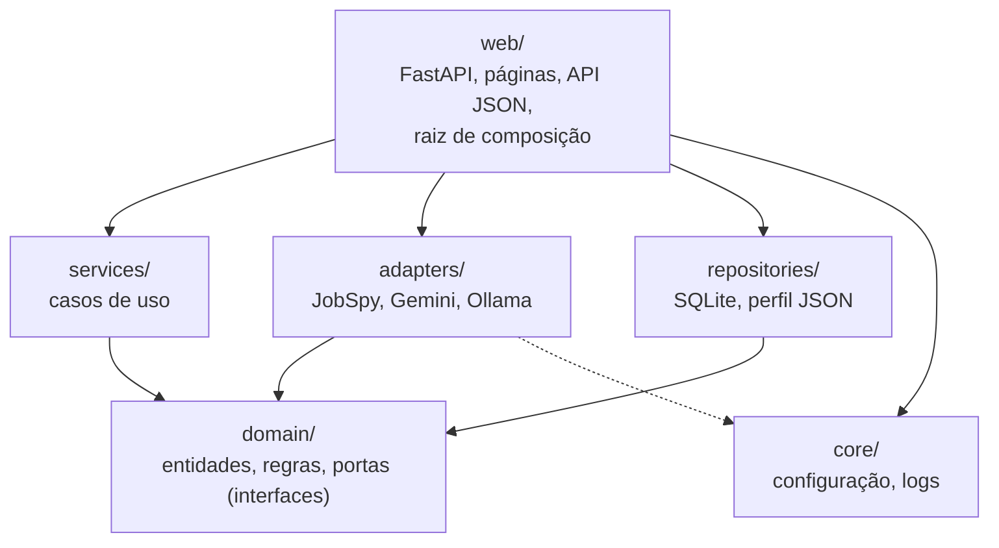
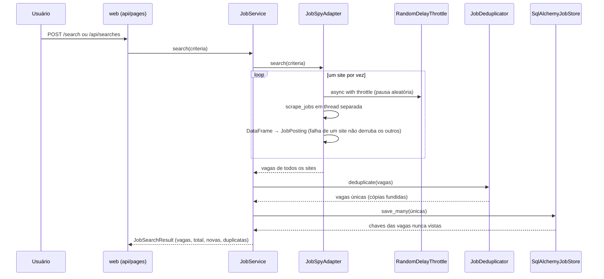

# Arquitetura

O copilot-job-gil busca vagas em sites de emprego, remove duplicatas entre fontes, avalia a
aderência de cada vaga ao perfil do candidato com um LLM e gera rascunhos de mensagens para
recrutadores. É uma aplicação pessoal, local, com interface web (FastAPI + Jinja2 + Tailwind)
e API JSON.

Este documento explica **como o código está organizado e por quê**. Para instalar e usar, veja
o [Guia do Usuário](USER_GUIDE.md).

## Sumário

1. [Camadas e regra de dependência](#1-camadas-e-regra-de-dependência)
2. [Estrutura de pastas](#2-estrutura-de-pastas)
3. [Portas e implementações](#3-portas-e-implementações)
4. [Fluxos principais](#4-fluxos-principais)
5. [Decisões de design](#5-decisões-de-design)
6. [Banco de dados e migrações](#6-banco-de-dados-e-migrações)
7. [Segurança](#7-segurança)
8. [Testes](#8-testes)
9. [Como estender](#9-como-estender)
10. [Limitações conhecidas](#10-limitações-conhecidas)

---

## 1. Camadas e regra de dependência



**Regra central: tudo aponta para `domain/`, e `domain/` não aponta para nada.** O domínio
não importa FastAPI, SQLAlchemy, JobSpy, pandas nem SDKs de LLM, só a biblioteca padrão.

| Camada | Responsabilidade | Pode depender de |
|---|---|---|
| `domain/` | Entidades imutáveis, regras de negócio puras (chave de deduplicação, fusão de cópias, veredito do match, limites de canal), portas (interfaces) e erros de domínio | nada |
| `services/` | Casos de uso: orquestram portas para cumprir um objetivo (buscar, avaliar, redigir) | `domain/` |
| `adapters/` | Traduzem serviços externos (JobSpy, Gemini, Ollama) para as portas do domínio, convertendo erros de SDK em erros de domínio | `domain/`, `core/` |
| `repositories/` | Persistência: SQLite via SQLAlchemy assíncrono e o perfil em JSON | `domain/` |
| `web/` | HTTP (páginas e API), tradução de erros em status HTTP, e a **raiz de composição**, o único lugar que conhece as implementações concretas | todas |
| `core/` | Configuração (`pydantic-settings`) e logs | nada do projeto |

Consequência prática: trocar o Ollama pelo Gemini, o SQLite por outro banco ou o JobSpy por outra
fonte não altera nenhuma linha de `domain/` nem de `services/`.

## 2. Estrutura de pastas

```
app/
├── core/
│   ├── config.py              Settings: variáveis de ambiente e .env, validadas na subida
│   └── logging.py
├── domain/
│   ├── models.py              Entidades, value objects e regras puras
│   ├── interfaces.py          Portas (ABCs) que services e web usam
│   └── exceptions.py          Hierarquia DomainError
├── services/
│   ├── job_service.py         Busca, deduplicação e persistência; aponta vagas novas
│   ├── deduplication.py       Agrupa cópias da mesma vaga e as funde
│   ├── match_engine.py        Score híbrido: skills + avaliação do LLM
│   ├── match_service.py       Match com cache invalidado pelo perfil
│   └── outreach_service.py    Rascunhos de mensagens para recrutadores
├── adapters/
│   ├── jobspy_adapter.py      IJobRepository sobre python-jobspy
│   ├── rate_limit.py          RandomDelayThrottle: pausa aleatória entre requisições
│   ├── gemini_adapter.py      ILLMProvider sobre google-genai
│   ├── ollama_adapter.py      ILLMProvider sobre a API REST do Ollama (httpx)
│   ├── llm_factory.py         Escolhe o provedor pela configuração
│   └── job_repository_factory.py
├── repositories/
│   ├── database.py            Engine, sessões, PRAGMAs e transação de escrita
│   ├── orm.py                 Tabelas (nunca expostas ao domínio)
│   ├── job_store.py           IJobStore
│   ├── match_store.py         IMatchResultStore
│   ├── outreach_store.py      IOutreachStore
│   ├── profile_repository.py  IProfileRepository: lê profile.json e recarrega se mudar
│   ├── migrate.py             Aplica as migrações a partir do código
│   └── migrations/            Alembic (env.py e versions/)
└── web/
    ├── app.py                 create_app(): FastAPI, lifespan, rotas, erros
    ├── container.py           Raiz de composição: monta e libera as dependências
    ├── api.py                 Rotas /api/* (JSON)
    ├── pages.py               Rotas HTML
    ├── schemas.py             Contratos HTTP (Pydantic), também usados pelos templates
    ├── dependencies.py        Dependências do FastAPI e proteção de origem (CSRF)
    ├── errors.py              DomainError → status HTTP (JSON ou HTML)
    ├── templating.py          Jinja2: filtros e rótulos em português
    └── templates/
tests/
├── doubles.py                 Dublês compartilhados (LLM, fonte de vagas, stores em memória)
├── conftest.py                Banco SQLite em memória criado pelas migrações reais
├── unit/                      Regras de negócio, services e adapters, isolados
├── regression/                Deduplicação, contratos das portas, migrações, concorrência
└── e2e/                       Aplicação completa via HTTP (API e páginas)
profile_data/                  profile.example.json (versionado) e profile.json (local)
main.py                        Ponto de entrada (uvicorn em 127.0.0.1:8000)
```

## 3. Portas e implementações

As portas ficam em `app/domain/interfaces.py`. Cada uma é pequena e tem um único papel. Buscar
vagas na web (`IJobRepository`) e guardá-las (`IJobStore`) são portas separadas, porque mudam
por motivos diferentes.

| Porta | Papel | Implementação | Dublê de teste |
|---|---|---|---|
| `IJobRepository` | Buscar vagas em fontes externas | `JobSpyAdapter` | `FakeJobRepository` |
| `IJobStore` | Guardar vagas já vistas; informar quais são novas | `SqlAlchemyJobStore` | `InMemoryJobStore` |
| `IMatchResultStore` | Guardar o match de cada vaga | `SqlAlchemyMatchResultStore` | `InMemoryMatchResultStore` |
| `IOutreachStore` | Histórico de rascunhos por vaga | `SqlAlchemyOutreachStore` | `InMemoryOutreachStore` |
| `IProfileRepository` | Fornecer o perfil do candidato | `JsonProfileRepository` | (arquivo temporário) |
| `ILLMProvider` | Gerar texto e JSON | `GeminiAdapter`, `OllamaAdapter` | `MockLLMAdapter`, `ScriptedLLMAdapter` |

**Contrato de erros.** Adapters e repositórios nunca deixam escapar exceções de bibliotecas
externas. Eles as convertem em erros de `app/domain/exceptions.py`, que a camada web traduz em
status HTTP:

| Erro de domínio | Significado | HTTP |
|---|---|---|
| `JobNotFoundError` | Vaga não armazenada | 404 |
| `JobSourceError` | Todas as fontes de vagas falharam | 502 |
| `LLMResponseFormatError` | O LLM respondeu fora do contrato | 502 |
| `OutreachGenerationError` | O LLM não respeitou o limite do canal nem após reescrita | 502 |
| `LLMProviderError` | O LLM não respondeu (fora do ar, quota, timeout) | 503 |
| `ProfileError` | Perfil ausente ou inválido | 503 |

Nas rotas `/api/*` a resposta é JSON (`{"detail": "..."}`); nas páginas, `error.html`.

## 4. Fluxos principais

### 4.1 Busca de vagas



### 4.2 Match perfil × vaga

`MatchEngine` calcula um **score híbrido**:

```
keyword_score = 100 × (skills do perfil citadas na vaga) / (total de skills do perfil)
score         = 0,4 × keyword_score + 0,6 × nota do LLM (0–100)
```

- Skills são comparadas sem diferenciar maiúsculas nem acentos, por palavra inteira: "Java" não
  casa com "JavaScript", e "C#" e "Node.js" funcionam.
- A nota do LLM é limitada a 0–100. Se o LLM falhar ou responder fora do contrato, o engine
  **degrada** para `score = keyword_score` e marca o resultado como "sem LLM".
- Veredito: ≥ 80 forte · ≥ 65 bom · ≥ 45 fraco · abaixo disso, pouca aderência.

`MatchService` adiciona o cache. O match salvo é reaproveitado **somente se**:

1. foi calculado com o perfil atual (mesmo `CandidateProfile.fingerprint`), **e**
2. usou o LLM (um match de fallback é recalculado na próxima oportunidade).

Caso contrário, ou com `force=True`, o match é recalculado e gravado por cima do anterior.

### 4.3 Mensagens para recrutadores

`OutreachService.draft()` monta um prompt com o perfil (a única fonte de fatos permitida), a vaga
e, se o match for do perfil atual, as skills em comum e os pontos fortes. As lacunas nunca
entram. O system prompt proíbe inventar fatos, mencionar pontos fracos e usar placeholders.

| Canal | Limite do corpo | Assunto |
|---|---|---|
| Convite de conexão (LinkedIn) | 300 (limite da plataforma) | não |
| Mensagem (LinkedIn) | 1000 (escolha editorial) | não |
| E-mail | 1500 (escolha editorial) | obrigatório |

Se o corpo vier acima do limite, o serviço pede **uma** reescrita ao LLM, informando o tamanho
obtido. Se ainda vier longo, lança `OutreachGenerationError`: cortar a mensagem a deixaria sem
sentido. Cada geração cria um novo rascunho; o histórico nunca é sobrescrito.

## 5. Decisões de design

### 5.1 Chave de deduplicação (`JobPosting.dedup_key`)

A mesma vaga aparece em sites diferentes com formatações diferentes. A chave é um SHA-256
(16 caracteres) de três partes normalizadas:

| Parte | Normalização | Exemplo |
|---|---|---|
| Título (`canonical_title`) | minúsculas, sem acentos e sem pontuação; remove palavras que não mudam qual vaga é (modo de trabalho, país, conectivos, marcador de gênero "(a)"); **conjunto ordenado** de palavras | "Desenvolvedor(a) Python Sênior - Remoto" → `desenvolvedor python senior` |
| Empresa (`canonical_company`) | sem sufixo societário | "ACME Ltda.", "Acme S.A." → `acme` |
| Local (`canonical_location`) | só a cidade | "São Paulo, SP, BR", "São Paulo - SP" → `sao paulo` |

**A senioridade é preservada**: "Senior" e "Junior", ou "Engineer I" e "Engineer II", continuam
sendo vagas diferentes.

**Vagas remotas pelo título ignoram o local**, porque empresas publicam a mesma vaga remota uma
vez por cidade ou estado (caso real observado: a mesma vaga remota da BairesDev no RJ e no RS).

Por que a regra usa só o título, e não o campo `work_mode`: com uma única chave por vaga,
nenhuma regra resolve todos os casos, e a escolhida preserva o mais comum.

| Cenário | Local sempre | **Remoto pelo título (escolhida)** | Remoto por qualquer evidência |
|---|---|---|---|
| Mesmo título e cidade, flags de remoto diferentes entre sites | ✅ | ✅ | ❌ |
| Mesma vaga remota publicada por região | ❌ | ✅ | ✅ |
| "X - Remoto" num site e "X" em uma cidade no outro | ✅ | ❌ | depende da flag |

Por que normalizar palavras em vez de medir semelhança entre títulos: a chave é **persistida**
e precisa ser determinística para cada vaga isoladamente. Semelhança é uma relação entre pares
e não gera uma chave.

> ⚠️ **A chave é gravada no banco.** Mudar o algoritmo invalida as chaves existentes.
> `tests/regression/test_deduplication.py::test_dedup_key_value_is_stable` fixa o valor de uma
> chave e falha em qualquer mudança. Só atualize esse valor junto com uma migração de dados.

### 5.2 Fusão de cópias (`JobPosting.merged_with`)

Quando duas cópias têm a mesma chave, a **primeira** define a identidade exibida (URL, fonte,
título) e a outra só **completa lacunas**:

- descrição: a mais longa;
- salário, modo de trabalho e tipo de contrato: da cópia principal; da outra só se faltarem;
- skills: união, sem repetição;
- data: a mais antiga, que é a publicação original;
- `other_listings`: os anúncios das outras fontes, sem repetir URLs.

A regra fica no domínio porque é usada em dois lugares: pela deduplicação dentro de uma busca e
pelo `SqlAlchemyJobStore` quando uma vaga já gravada reaparece. A chave é estável sob fusão:
cópias com a mesma chave têm o mesmo título normalizado e, se não forem remotas, o mesmo local.

### 5.3 Modo de trabalho (`detect_work_mode`)

O `JobSpyAdapter` decide o modo de trabalho nesta ordem:

1. o que a empresa escreveu no **título ou no local** ("Trabalho Remoto", "Híbrido", "On-site");
2. o tipo de trabalho informado pelo JobSpy;
3. a flag `is_remote`.

**A descrição não é usada**: menções como "auxílio home office" ou "não é remoto" gerariam falsos
positivos. Uma vaga sem declaração clara fica como "não informado", o que é melhor que um valor
errado.

### 5.4 Rate limit na ingestão

O `scrape_jobs` do JobSpy dispara todos os sites em paralelo. O `JobSpyAdapter` chama **um site
por vez**, cada chamada dentro do `RandomDelayThrottle`:

- a pausa é sorteada entre `JOBSPY_MIN_DELAY_SECONDS` e `JOBSPY_MAX_DELAY_SECONDS`, porque um
  intervalo fixo é fácil de detectar como bot;
- ela é contada a partir do **fim** da requisição anterior;
- as requisições são serializadas, mesmo que haja buscas simultâneas;
- o scraping, que é bloqueante, roda em `asyncio.to_thread`.

### 5.5 Configuração validada na subida

`Settings` falha ao iniciar, com mensagem clara, se a configuração for incoerente: Gemini sem
chave, delay mínimo maior que o máximo, timeout ≤ 0 ou provedor desconhecido. A chave do Gemini
é `SecretStr` e não aparece em logs nem no `repr`.

## 6. Banco de dados e migrações

### Tabelas

| Tabela | Chave | Observações |
|---|---|---|
| `jobs` | `id` (sequencial) + `dedup_key` (única) | `first_seen_at` e `last_seen_at`; o `id` preserva a ordem da busca na listagem |
| `match_results` | `job_key` → `jobs.dedup_key` | um por vaga; guarda `profile_fingerprint`; `ON DELETE CASCADE` |
| `outreach_messages` | `id`, `job_key` → `jobs.dedup_key` | histórico; `ON DELETE CASCADE` |

### Configurações do SQLite (`repositories/database.py`)

- `foreign_keys=ON`: sem isso, o SQLite ignora as chaves estrangeiras;
- `journal_mode=WAL`: leituras não bloqueiam a escrita;
- `busy_timeout=5000`: espera a trava em vez de falhar na hora.

### Concorrência

Havia um problema real: duas gravações simultâneas liam o mesmo estado, as duas concluíam
"vaga nova" e a segunda falhava com `UNIQUE constraint failed` (30 de 30 rodadas no teste de
reprodução).

- **Vagas:** `save_many` lê e depois grava com base no que leu, e a fusão roda em Python, então
  um upsert em SQL não basta. A solução é `write_transaction()`, que abre a transação com
  `BEGIN IMMEDIATE` e reserva a escrita já no início. A segunda transação espera a primeira e lê
  o estado atualizado.
- **Matches:** substituir o match é uma operação completa, então é um upsert nativo
  (`INSERT … ON CONFLICT DO UPDATE`). A existência da vaga é garantida pela chave estrangeira,
  e não por uma consulta prévia sujeita a corrida.

`test_sqlite_repositories.py` reproduz os dois cenários com duas conexões no mesmo arquivo.

### Migrações (Alembic)

- As migrações ficam em `app/repositories/migrations/versions/` e são aplicadas **automaticamente
  na subida** (`upgrade_to_head` no lifespan).
- `render_as_batch=True` e nomes explícitos de constraints permitem alterar tabelas no SQLite,
  que suporta pouco `ALTER TABLE` e por isso recria a tabela inteira.
- `env.py` aceita uma conexão já aberta: é assim que a aplicação e os testes, inclusive com banco
  em memória, aplicam migrações sem abrir um segundo event loop.

Fluxo para mudar o esquema:

```bash
# 1. edite app/repositories/orm.py
uv run alembic revision --autogenerate -m "descrição"
# 2. revise o arquivo gerado (ex.: server_default para linhas existentes)
uv run alembic upgrade head
uv run pytest tests/regression/test_migrations.py
```

`test_migrations.py` garante que o esquema das migrações é idêntico ao dos modelos, que há uma
só linha de migrações, que desfazer e refazer funciona, e que uma migração nova roda sobre um
banco que já tem dados.

## 7. Segurança

A aplicação é pessoal e **não tem autenticação**. As proteções partem desse pressuposto:

| Risco | Proteção |
|---|---|
| Acesso pela rede | `main.py` escuta só em `127.0.0.1` |
| Outro site enviar formulários para `localhost` (CSRF), disparando buscas ou chamadas pagas ao LLM | **Páginas:** `require_same_origin` exige `Origin` ou `Referer` do próprio host em todo POST. **API:** `reject_cross_origin` recusa qualquer requisição cujo `Origin` seja de outro host. Navegadores sempre enviam `Origin` em POSTs de outro site; `curl` e scripts não enviam e continuam funcionando. Isso é necessário porque `POST /api/jobs/{key}/match` não tem corpo JSON e um formulário comum conseguiria chamá-lo. Nos endpoints com corpo, o FastAPI também recusa (422) corpos que não sejam `application/json` |
| HTML ou script vindo das vagas ou do LLM (XSS) | Jinja2 escapa tudo por padrão; nenhum conteúdo externo usa `|safe` |
| Links `javascript:` nas URLs das vagas | filtro `safe_url` só aceita `http` e `https` |
| Vazamento da chave do Gemini | `SecretStr`; `.env` está no `.gitignore` |
| Vazamento do perfil | `profile_data/profile.json` está no `.gitignore` |

Os testes e2e injetam `<script>` e `javascript:` nos dados das vagas e nas respostas do LLM e
verificam que nada é executado.

## 8. Testes

```bash
uv run pytest                 # 307 testes
uv run pytest -m unit         # 152: regras, services e adapters isolados
uv run pytest -m regression   # 104: deduplicação, contratos, migrações, concorrência
uv run pytest -m e2e          # 51: aplicação completa via HTTP
```

**Princípios:**

- **Sem rede:** adapters são testados com clientes falsos (`httpx.MockTransport` para o Ollama e
  um cliente falso do `google-genai`) e DataFrames reais no formato do JobSpy.
- **Testes de contrato:** os testes de cada store rodam **duas vezes**, contra o SQLite real e
  contra o dublê em memória (`@pytest.fixture(params=["sqlite", "in_memory"])`). Isso garante
  que os testes unitários, que usam o dublê, refletem o comportamento real.
- **Banco pelas migrações:** o fixture `session_factory` cria o banco com as migrações reais,
  e não com `create_all`, então os testes exercitam o mesmo esquema da produção.
- **e2e com a aplicação real:** `TestClient` executa o lifespan completo (migrações, container,
  perfil lido de arquivo); só a fonte de vagas e o LLM são dublês, via `Overrides`.
- **Regressão de casos reais:** comportamentos observados em buscas reais (BairesDev por região,
  "Trabalho Remoto" no título) viraram testes com os títulos originais.
- **Sem espera real:** o throttle recebe relógio e `sleep` injetados.

## 9. Como estender

### Novo provedor de LLM

1. Crie `app/adapters/<nome>_adapter.py` implementando `ILLMProvider`: `name`, `generate`,
   `generate_json` e, se abrir conexões, `aclose`.
2. Converta todos os erros do SDK em `LLMProviderError`, e respostas fora do formato em
   `LLMResponseFormatError`.
3. Adicione o nome em `LLMProviderName` (`core/config.py`), as configurações necessárias e uma
   entrada em `_BUILDERS` (`adapters/llm_factory.py`).
4. Teste com um cliente falso, seguindo `tests/unit/test_ollama_adapter.py`.

Nenhum service precisa mudar.

### Nova fonte de vagas

Implemente `IJobRepository` convertendo os resultados em `JobPosting` e lançando
`JobSourceError` quando a fonte falhar. Reutilize `RandomDelayThrottle` e troque a
implementação em `adapters/job_repository_factory.py`.

### Novo campo em uma entidade persistida

1. Adicione o campo em `domain/models.py` (e em `merged_with`, se for de `JobPosting`).
2. Adicione a coluna em `repositories/orm.py` e o mapeamento no store correspondente.
3. Gere a migração (seção 6) e inclua o campo no teste de ida e volta do contrato do store.
4. Atualize os dublês em `tests/doubles.py`, se necessário. Os testes de contrato vão apontar
   divergências.

### Mudar a chave de deduplicação

Leia a seção 5.1 antes. A mudança exige recalcular `dedup_key` de todas as vagas gravadas
(migração de dados) e tratar colisões entre vagas que passarão a ter a mesma chave.

## 10. Limitações conhecidas

| Limitação | Impacto | Caminho possível |
|---|---|---|
| "X - Remoto" num site e "X" em uma cidade no outro não são reconhecidas como a mesma vaga | Duplicata eventual na lista | Várias chaves de identidade por vaga, numa tabela à parte |
| Busca, match e rascunhos rodam enquanto a página espera | 10 s a 1,5 min por operação com LLM local | Tarefas em segundo plano com acompanhamento de progresso |
| Tailwind carregado de CDN | A interface precisa de internet para ter estilo | Gerar o CSS no build |
| JobSpy não informa a data de publicação de vagas do LinkedIn | Coluna de data vazia nessas vagas | Depende do JobSpy |
| Qualidade do texto depende do modelo | Modelos locais pequenos (`llama3.1` 8B) produzem clichês | Usar Gemini ou um modelo local maior |
| Sem autenticação | Não pode ser exposta na rede | Autenticação antes de qualquer uso fora de `127.0.0.1` |
